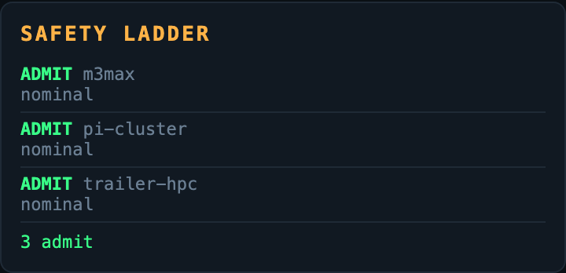
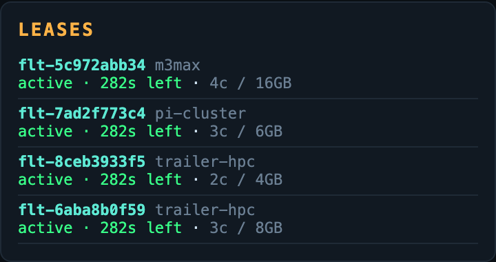

# The Tower

```text
        ✈                                      ✈
   ✈        \        |        /                    ✈
             \       |       /
              \      |      /
               \     |     /
                \    |    /
                 \   |   /
                  \  |  /
                   \ | /
    .---------------\|/---------------.
   /                 |                 \
  /    RUNWAY 09/27  |                  \
 /                   |                   \
|                    |                    |
|   [CONTROL TOWER]  |                    |
|        |           |                    |
|  ============ TERMINAL ============     |
|_________________________________________|
         |      |      |      |
    _____|______|______|______|_____
   /                                \
  /__________________________________\
```

[](https://github.com/hamanakam1/the-tower/actions/workflows/ci.yml)
[](LICENSE)
[](https://www.python.org/)
[](Dockerfile)
[](https://github.com/hamanakam1/the-tower/releases)

**Hardware Air Traffic Control for the Autonomous Mesh**

The Tower sits above the execution layer, monitors the physical airspace, clears compute tasks for takeoff, and ruthlessly shoots down rogue flights before they melt a motherboard.

> **📋 [Long-Term Plan](docs/roadmap.md)** — where this is going, how it should be built, and what has to be true before each release. Read it before proposing a feature.

```text
TTTTT H   H EEEEE TTTTT  OOO  W   W EEEEE RRRR
  T   H   H E       T   O   O W   W E     R   R
  T   HHHHH EEEE    T   O   O W W W EEEE  RRRR
  T   H   H E       T   O   O WW WW E     R  R
  T   H   H EEEEE   T    OOO  W   W EEEEE R   R
```

## Purpose

Unlike cloud-native applications that assume infinite compute, The Tower operates in the physical realm - monitoring thermals, power, memory, and bandwidth across a heterogeneous mesh of Apple Silicon, Raspberry Pi nodes, and off-grid solar-powered trailer compute.

## The dashboard


One page, everything the tower knows. The radar sweep plots the nodes by
bearing and range; the flight board lists every task in the air, in flight or
queued; the event log is the audit trail; and the node panel reports the live
thermals, memory and power of each machine in the mesh. Every node card says
whether the Tower is `advisory` or `enforce` for that node, and carries the
control to arm or disarm it.

<table>
  <tr>
    <td width="50%"><br><sub><b>radar</b> &mdash; one sweep across every node, five seconds apart. Bearing and range, so you can see who is crowding whom.</sub></td>
    <td width="50%"><br><sub><b>flight board</b> &mdash; every task in the air, in flight, or queued, with the node it is assigned to and why it was denied.</sub></td>
  </tr>
  <tr>
    <td width="50%"><br><sub><b>nodes</b> &mdash; live CPU, memory, temperature and power per machine, with the redline that triggers the kill-switch.</sub></td>
    <td width="50%"><br><sub><b>event log</b> &mdash; every clearance request, denial and kill, in the order it happened. This is the record you read after something goes wrong.</sub></td>
  </tr>
  <tr>
    <td width="50%"><br><sub><b>anti-air battery</b> &mdash; the kill console. It needs a reason, it only stops processes the Tower was given ownership of, and it can give a flight a grace period to land first.</sub></td>
    <td width="50%"><br><sub><b>trends</b> &mdash; thermal slope and memory slope per node, and the estimated time to the power redline. A node that is trending to failure gets warned about before it fails.</sub></td>
  </tr>
  <tr>
    <td width="50%"><br><sub><b>safety ladder</b> &mdash; where each node sits on admit &rarr; warn &rarr; throttle &rarr; drain &rarr; kill, and why. Advisory nodes are told; enforced nodes are acted on.</sub></td>
    <td width="50%"><br><sub><b>leases</b> &mdash; the Tower's time-bounded claims on node resources. When a lease expires the resources come back and the flight is rescheduled.</sub></td>
  </tr>
  <tr>
    <td width="50%"><br><sub><b>clearance request</b> &mdash; ask for takeoff with a resource weight, a priority and an optional node preference.</sub></td>
    <td width="50%"><br><sub><b>containers</b> &mdash; every registered container and the last time it was heard from. Silence is what gets a container killed.</sub></td>
  </tr>
</table>

Every screenshot above was captured from a running Tower seeded with the
synthetic demo fleet, so the callsigns and the telemetry are fictional. The
same console on a narrow viewport:


## Architecture

1. **Panther** → Captures raw multimodal signals
2. **El Destilador** → Distills into semantic intent
3. **Ticket Board [PRIVATE]** → Human roadmap (never read by Tower)
4. **El Hidratador** → Builds sandbox DAG, requests clearance
5. **THE TOWER** → Hardware ATC, dispatch, and kill-switch
6. **Taskrivet** → Worker execution
7. **El Verificador** → QA and retry loop
8. **El Cronista** → Meta-learning
9. **EdgeRecord** → Immutable audit ledger

## Core Systems

- **Radar Sweep** - 5-second telemetry polling across all nodes (real psutil + simulated edge nodes)
- **Pure Policy Core** - Admission is a pure function of a frozen snapshot (`the_tower/policy.py`): no I/O, no clock, replayable
- **Safety Ladder** - Graded enforcement: admit → warn → throttle → drain → kill (`the_tower/safety.py`)
- **Leases** - Time-bounded claims on node resources, with renewal, expiry and automatic rescheduling
- **Node Lifecycle** - `online → draining → cordoned → maintenance → offline → unknown`
- **Flight Clearance** - Dynamic dispatch algorithm based on resource weight and node scoring
- **Anomaly Radar** - Predictive ML on thermal/memory/power trends (linear regression + z-score spikes)
- **Anti-Air Battery** - Kill console for runaway processes and stale containers; a kill requires a reason, only ever signals a process the Tower was given ownership of, and can give a flight a grace period to land before it is terminated
- **Process Ownership** - The Tower keeps an explicit registry of the PIDs it may stop; a container id that merely looks like a PID is never treated as one
- **Draining** - A flight given a grace period enters `draining`, keeps its claim on the node, lands if it finishes in time and is terminated when the deadline passes
- **Scope Conflicts** - Resource-key conflict detection with priority preemption
- **Priority Dispatch Queue** - Queued flights re-dispatched when capacity frees
- **Container Registry** - Heartbeat-based liveness; a silent container is killed where the Tower is allowed to act and reported once a minute where it is not
- **Freshness** - Stale telemetry makes a node `unknown`, and unknown nodes are never scheduled onto
- **Advisory Mode** - Per-node opt-in: the Tower recommends instead of acting
- **Explainability** - Every clearance carries the node state it saw, the score of every candidate and a policy version — and can be replayed later
- **Persistence** - SQLite-backed flights, events, telemetry, audit hash chain, versioned migrations, rolled-up telemetry
- **Live Push** - WebSocket airspace broadcasts
- **Auth** - Optional bearer token for every mutating endpoint and the WebSocket; the dashboard asks for it once and remembers it
- **Metrics** - Prometheus `/metrics` endpoint
- **Telemetry Agent** - `the-tower agent` pushes local node metrics
- **Container** - Dockerfile for one-command deployment

## Hardware Topology

| Node | Role | Specs | Constraints |
|------|------|-------|-------------|
| M3 Max | Heavy Bomber | 128GB Unified Memory, Apple Silicon | Thermal throttling under sustained load |
| Raspberry Pi 5 Cluster | Drone Swarm | Multiple nodes | 80°C redline, limited RAM/power |
| Mobile HPC Trailer | Off-grid Compute | Solar + battery banks | Constrained by SoC/battery discharge |

## Quick Start

```bash
pip install -e .
the-tower serve            # API + dashboard on http://127.0.0.1:8765
the-tower radar            # one-shot telemetry sweep
the-tower status --watch   # node health, live
the-tower config           # the effective configuration
the-tower demo             # seed demo flights against a running Tower
the-tower agent --tower http://<tower>:8765 --node-id pi-01   # node agent
```

### Container image

A published image is built and smoke-tested on every release tag.

```bash
docker pull ghcr.io/hamanakam1/the-tower:0.3.0
docker run --rm -p 8765:8765 ghcr.io/hamanakam1/the-tower:0.3.0
```

The image runs as a non-root user and keeps its database on the `/data`
volume. See the [package on GitHub](https://github.com/hamanakam1/the-tower/pkgs/container/the-tower).

## API Endpoints

- `POST /clearance` - Request flight clearance for a task
- `GET /radar` - Current mesh telemetry snapshot
- `GET /status/:node` - Per-node health details
- `POST /kill/:container` - Emergency kill (internal use)
- `GET /airspace` - Full airspace snapshot (nodes, flights, events, stats)
- `GET /events` - Recent tower events
- `GET /flights` - All flights
- `GET /trend/:node` - Thermal/memory trend analysis
- `POST /nodes` - Register a node
- `DELETE /nodes/:node` - Unregister a node
- `POST /containers` - Register a container
- `GET /containers` - List containers
- `POST /containers/:id/heartbeat` - Container heartbeat
- `GET /conflicts?scope=` - Scope conflict check
- `GET /audit/verify` - Verify audit hash chain
- `WS /ws` - Live airspace push
- `GET /metrics` - Prometheus metrics
- `GET /flights/:id` - Flight detail + related events
- `POST /clearance/v2` - Idempotent clearance contract (202 Accepted)
- `GET /decision/last` - The last admission decision, with its explainability block
- `GET /safety/ladder` - Enforcement ladder state per node
- `POST /nodes/:id/enforcement` - Switch a node between `advisory` (the default) and `enforce`; `mode` is required
- `GET /history/:node` - Recent telemetry samples for a node
- `GET /rollup` - Rolled-up telemetry history
- `GET /leases` - Active resource leases
- `POST /leases/:id/renew` - Renew a lease
- `DELETE /leases/:id` - Release a lease
- `GET /decisions` - Recorded clearance decisions
- `POST /replay` - Re-derive a decision from its recorded snapshot

## Adding a real node

One command, run on the machine that joins the mesh:

```bash
the-tower agent --tower http://tower.local:8765 --node-id pi-01 --register \
                --redline 80 --role "Drone" --location edge
```

`--register` describes the machine the agent is running on — real core
count, real memory, the redline you chose — and registers it with the Tower
as a node that reports for itself. The Tower stops simulating it and starts
reading what the machine actually says. A node with no temperature sensor
says so, and its readings are labelled `estimated` everywhere they appear.

Without `--register` the agent will tell you the node is not registered
rather than pushing into a 404 forever.

## Visualization


Open the dashboard at `http://127.0.0.1:8765/` for the live radar, node health, flight board, and anti-air battery controls. The panels are captured in [The dashboard](#the-dashboard) above.

## Target Architecture

The Tower is an admission-control plane for physical compute: it decides
where a task may run and what it may do to the machine, and it records every
decision.


This is the **proposed v1.0** target, not the current implementation. The
current implementation is a single-process prototype; the honest gap analysis
is in [the long-term plan](docs/roadmap.md#2-where-we-are-an-honest-read-of-v030),
and the machine-readable diagram source is
[`docs/architecture/tower-target.architecture.json`](docs/architecture/tower-target.architecture.json).

## Status

Working prototype - hardware ATC with telemetry, clearance dispatch, anomaly detection, and kill-switch.

**Read this before trusting it with real hardware.** Two of the three mesh
nodes are still simulated, and macOS exposes no CPU thermal sensor through
`psutil` — the local node's temperature is an estimate from CPU load, and the
dashboard says so on every sample. The kill path only signals processes the
Tower has been given ownership of, a kill needs a reason, and the audit chain
records admission decisions. A fresh Tower is **advisory**: it recommends a
kill or a preemption and never acts on its own until a node is explicitly put
into `enforce` mode. The
[long-term plan](docs/roadmap.md) lists every remaining gap with the horizon
that closes it, and the guarantees that now hold are listed
[there](docs/roadmap.md#the-guarantees-that-now-hold).

## License

MIT — see [LICENSE](LICENSE).
