# The Tower

```text
        ✈                                      ✈
   ✈        \        |        /                    ✈
             \       |       /
              \      |      /
               \     |     /
                \    |    /
                 \   |   /
                  \  |  /
                   \ | /
    .---------------\|/---------------.
   /                 |                 \
  /    RUNWAY 09/27  |                  \
 /                   |                   \
|                    |                    |
|   [CONTROL TOWER]  |                    |
|        |           |                    |
|  ============ TERMINAL ============     |
|_________________________________________|
         |      |      |      |
    _____|______|______|______|_____
   /                                \
  /__________________________________\
```

[](https://github.com/hamanakam1/the-tower/actions/workflows/ci.yml)
[](LICENSE)
[](https://www.python.org/)
[](Dockerfile)
[](https://github.com/hamanakam1/the-tower/releases)

**Hardware Air Traffic Control for the Autonomous Mesh**

The Tower sits above the execution layer, monitors the physical airspace, clears compute tasks for takeoff, and ruthlessly shoots down rogue flights before they melt a motherboard.

> **📋 [Long-Term Plan](docs/roadmap.md)** — where this is going, how it should be built, and what has to be true before each release. Read it before proposing a feature.

```text
TTTTT H   H EEEEE TTTTT  OOO  W   W EEEEE RRRR
  T   H   H E       T   O   O W   W E     R   R
  T   HHHHH EEEE    T   O   O W W W EEEE  RRRR
  T   H   H E       T   O   O WW WW E     R  R
  T   H   H EEEEE   T    OOO  W   W EEEEE R   R
```

## Purpose

Unlike cloud-native applications that assume infinite compute, The Tower operates in the physical realm - monitoring thermals, power, memory, and bandwidth across a heterogeneous mesh of Apple Silicon, Raspberry Pi nodes, and off-grid solar-powered trailer compute.

## The dashboard

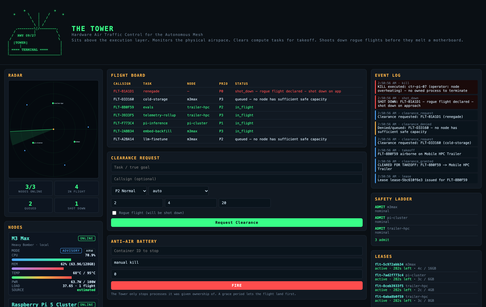

One page, everything the tower knows. The radar sweep plots the nodes by
bearing and range; the flight board lists every task in the air, in flight or
queued; the event log is the audit trail; and the node panel reports the live
thermals, memory and power of each machine in the mesh.

<table>
  <tr>
    <td width="50%">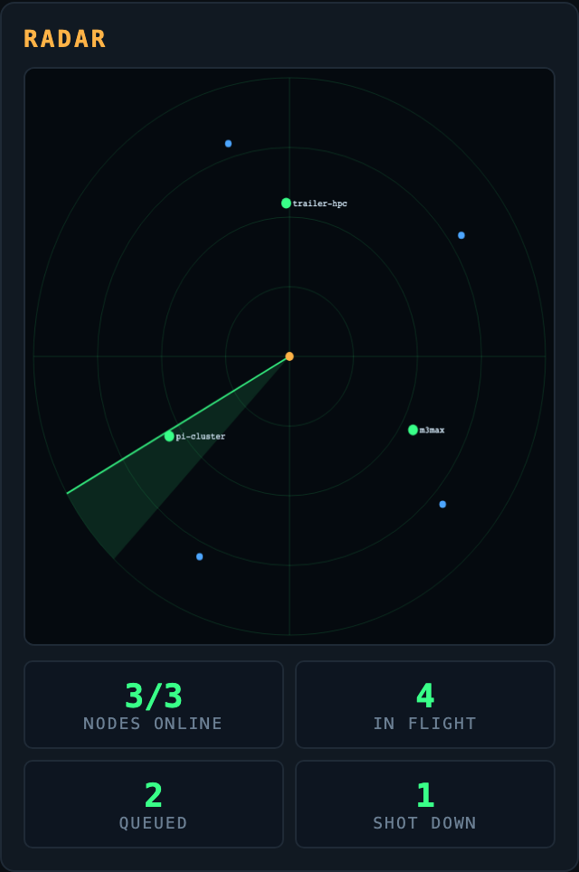<br><sub><b>radar</b> &mdash; one sweep across every node, five seconds apart. Bearing and range, so you can see who is crowding whom.</sub></td>
    <td width="50%">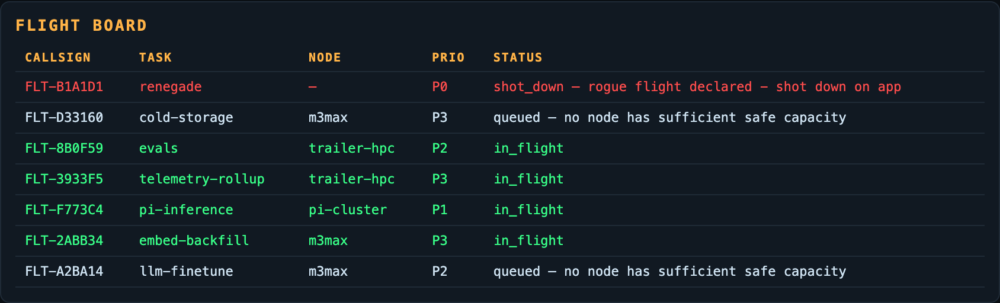<br><sub><b>flight board</b> &mdash; every task in the air, in flight, or queued, with the node it is assigned to and why it was denied.</sub></td>
  </tr>
  <tr>
    <td width="50%">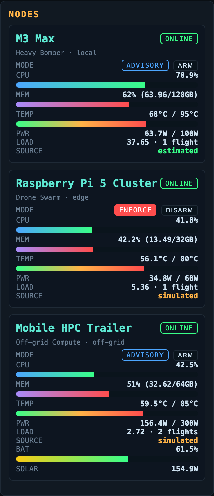<br><sub><b>nodes</b> &mdash; live CPU, memory, temperature and power per machine, with the redline that triggers the kill-switch.</sub></td>
    <td width="50%">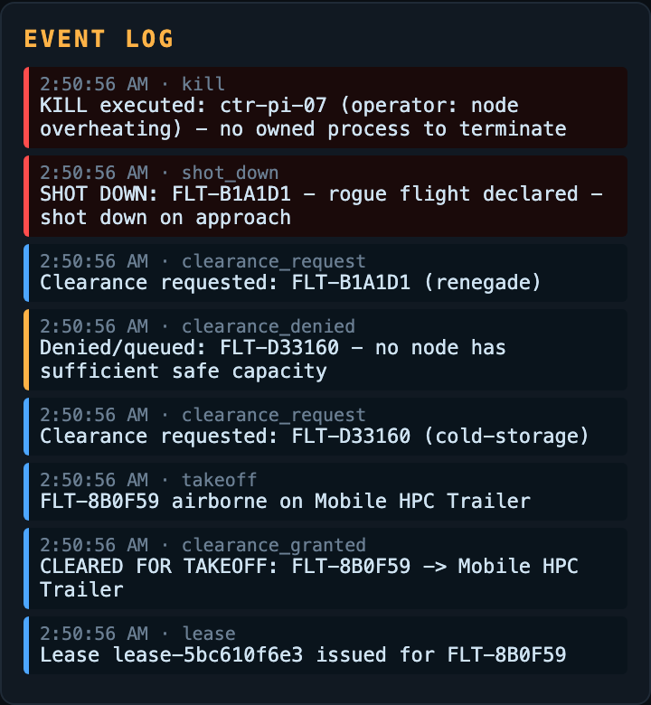<br><sub><b>event log</b> &mdash; every clearance request, denial and kill, in the order it happened. This is the record you read after something goes wrong.</sub></td>
  </tr>
  <tr>
    <td width="50%">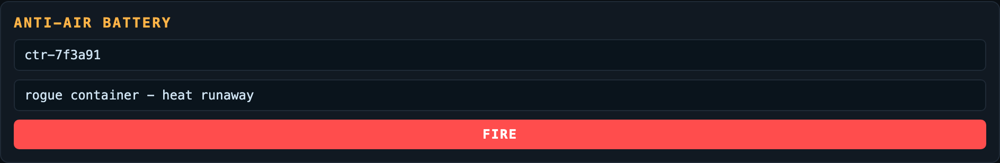<br><sub><b>anti-air battery</b> &mdash; the hard kill. Name a container and it dies; no approval, no grace period.</sub></td>
    <td width="50%">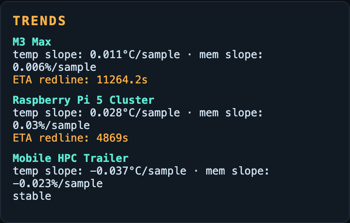<br><sub><b>trends</b> &mdash; thermal slope and memory slope per node, and the estimated time to the power redline. A node that is trending to failure gets warned about before it fails.</sub></td>
  </tr>
  <tr>
    <td width="50%">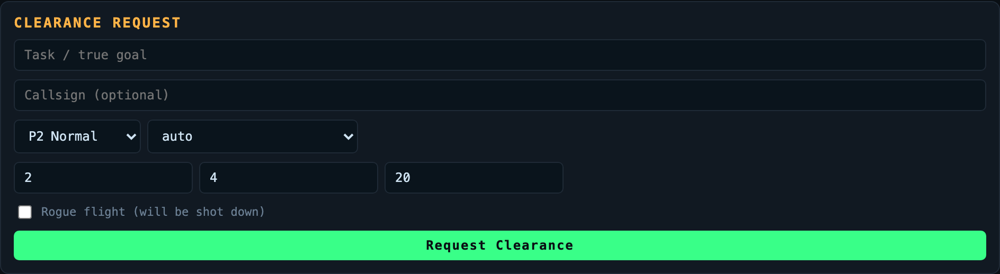<br><sub><b>clearance request</b> &mdash; ask for takeoff with a resource weight, a priority and an optional node preference.</sub></td>
    <td width="50%">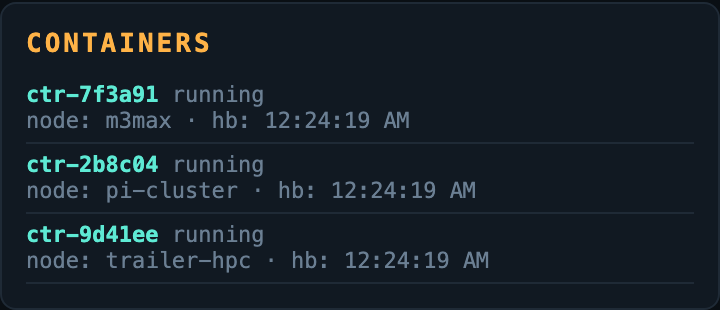<br><sub><b>containers</b> &mdash; every registered container and the last time it was heard from. Silence is what gets a container killed.</sub></td>
  </tr>
</table>

Every screenshot above was captured from a running Tower seeded with the
synthetic demo fleet, so the callsigns and the telemetry are fictional. The
same console on a narrow viewport:

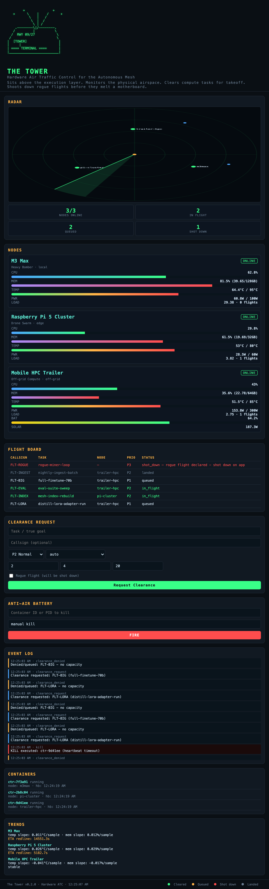

## Architecture

1. **Panther** → Captures raw multimodal signals
2. **El Destilador** → Distills into semantic intent
3. **Ticket Board [PRIVATE]** → Human roadmap (never read by Tower)
4. **El Hidratador** → Builds sandbox DAG, requests clearance
5. **THE TOWER** → Hardware ATC, dispatch, and kill-switch
6. **Taskrivet** → Worker execution
7. **El Verificador** → QA and retry loop
8. **El Cronista** → Meta-learning
9. **EdgeRecord** → Immutable audit ledger

## Core Systems

- **Radar Sweep** - 5-second telemetry polling across all nodes (real psutil + simulated edge nodes)
- **Flight Clearance** - Dynamic dispatch algorithm based on resource weight and node scoring
- **Anomaly Radar** - Predictive ML on thermal/memory/power trends (linear regression + z-score spikes)
- **Anti-Air Battery** - Hard-kill switch for runaway processes and stale containers
- **Scope Conflicts** - Resource-key conflict detection with priority preemption
- **Priority Dispatch Queue** - Queued flights re-dispatched when capacity frees
- **Container Registry** - Heartbeat-based liveness with auto-kill on timeout
- **Persistence** - SQLite-backed flights, events, telemetry, audit hash chain
- **Live Push** - WebSocket airspace broadcasts
- **Auth** - Optional bearer token for mutating endpoints
- **Metrics** - Prometheus `/metrics` endpoint
- **Telemetry Agent** - `the-tower agent` pushes local node metrics
- **Container** - Dockerfile for one-command deployment

## Hardware Topology

| Node | Role | Specs | Constraints |
|------|------|-------|-------------|
| M3 Max | Heavy Bomber | 128GB Unified Memory, Apple Silicon | Thermal throttling under sustained load |
| Raspberry Pi 5 Cluster | Drone Swarm | Multiple nodes | 80°C redline, limited RAM/power |
| Mobile HPC Trailer | Off-grid Compute | Solar + battery banks | Constrained by SoC/battery discharge |

## Quick Start

```bash
pip install -e .
the-tower serve            # API + dashboard on http://127.0.0.1:8765
the-tower radar            # one-shot telemetry sweep
the-tower status           # node health
```

## API Endpoints

- `POST /clearance` - Request flight clearance for a task
- `GET /radar` - Current mesh telemetry snapshot
- `GET /status/:node` - Per-node health details
- `POST /kill/:container` - Emergency kill (internal use)
- `GET /airspace` - Full airspace snapshot (nodes, flights, events, stats)
- `GET /events` - Recent tower events
- `GET /flights` - All flights
- `GET /trend/:node` - Thermal/memory trend analysis
- `POST /nodes` - Register a node
- `DELETE /nodes/:node` - Unregister a node
- `POST /containers` - Register a container
- `GET /containers` - List containers
- `POST /containers/:id/heartbeat` - Container heartbeat
- `GET /conflicts?scope=` - Scope conflict check
- `GET /audit/verify` - Verify audit hash chain
- `WS /ws` - Live airspace push
- `GET /metrics` - Prometheus metrics
- `GET /flights/:id` - Flight detail + related events

## Visualization

Open the dashboard at `http://127.0.0.1:8765/` for the live radar, node health, flight board, and anti-air battery controls. The panels are captured in [The dashboard](#the-dashboard) above.

## Target Architecture

The Tower is an admission-control plane for physical compute: it decides
where a task may run and what it may do to the machine, and it records every
decision.

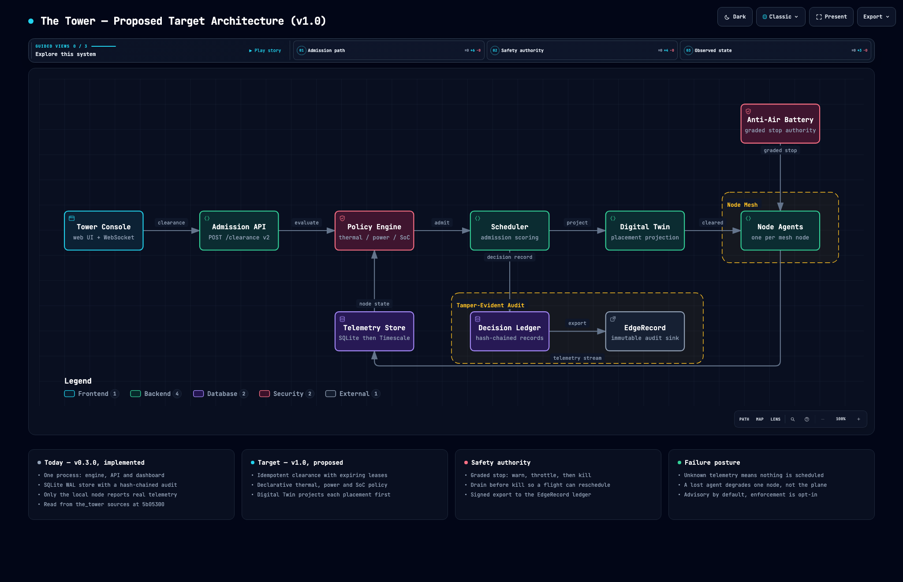

This is the **proposed v1.0** target, not the current implementation. The
current implementation is a single-process prototype; the honest gap analysis
is in [the long-term plan](docs/roadmap.md#2-where-we-are-an-honest-read-of-v030),
and the machine-readable diagram source is
[`docs/architecture/tower-target.architecture.json`](docs/architecture/tower-target.architecture.json).

## Status

Working prototype - hardware ATC with telemetry, clearance dispatch, anomaly detection, and kill-switch.

**Read this before trusting it with real hardware.** Two of the three mesh
nodes are still simulated, the kill path will `SIGKILL` any numeric container
id, and the audit chain does not yet record admission decisions. The
[long-term plan](docs/roadmap.md) lists every gap with the horizon that
closes it.

## License

MIT — see [LICENSE](LICENSE).
